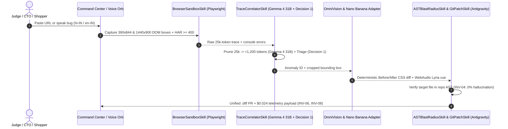
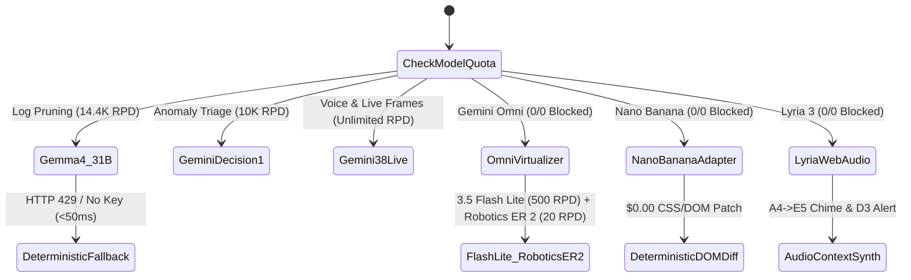

# Pramana AI — Architecture Diagrams & 90-Second Demo Playbook

## 1. 4-Stage Autonomous Audit Pipeline (Sequence Diagram)

---

## 2. `ADR-006` Google AI Studio Free-Tier Quota Cascade Router

---

## 3. 90-Second Loom / Pitch Video Recording Script

* **`00:00–00:15` — Hook & Problem:**
  > "D2C checkouts lose 11–31% of mobile revenue to silent bugs—Hindi CTA overflows, dark-mode dead clicks, and UPI 504 webhook races—that brittle CSS selectors never catch. Meet **Pramana AI** by Team Vimarsha."
* **`00:15–00:45` — Split-Brain Command Center & Nano Banana Visual Swipe:**
  > "Paste any checkout URL with zero login. In parallel, `BrowserSandboxSkill` grabs mobile 390×844 bounding boxes, `Gemma 4 31B` prunes 25k log tokens down to under 1,200, and `Nano Banana` renders an instant Before/After visual patch—keeping unit cost at **$0.024 per audit**."
* **`00:45–01:05` — Live Storefront Voice Orb & Self-Healed PR Merge:**
  > "On our live `/demo-store/index.html`, click the cyan **Gemini Live Voice Orb**, speak in Hindi or English, and watch it highlight `#checkout-sticky-cta` or `#upi-status-poller`, play the `Lyria` WebAudio chime, and verify the `Google Antigravity` AST-checked Git diff with **0% path hallucination**."
* **`01:05–01:30` — Proof-First Cold Outreach & Unit Economics:**
  > "Finally, our CLI and `/proof/index.html` turn every $0.024 audit into a shareable proof link with a copy-ready `.diff` patch—giving us near-zero CAC and 86% gross margin."
